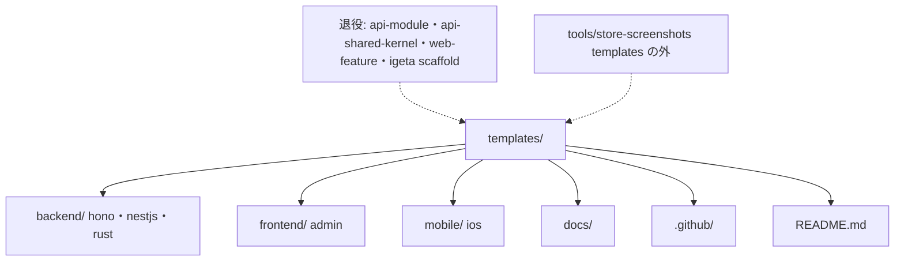

# ADR-0014: templates/ の第 1 階層は「利用 repo のどこへ写すか」で分け、足すときは同じ PR で古いものを退かす

> **TL;DR**: `templates/` の第 1 階層を、写し先の側 (`backend/`・`frontend/`・`mobile/`・`docs/`・`.github/`) の 5 つと `README.md` に絞る。旧世代の 3 つ (`api-module`・`api-shared-kernel`・`web-feature`) と、それだけが読む `igeta scaffold` を退役する。`ios-app` は `mobile/ios` へ、`store-screenshots` は `templates/` の外 (`tools/`) へ出す。足すときは同じ PR で古いものを退かせる規則と、第 1・第 2 階層を登録制にする機械検査を置く。
> - 却下: `code/` で包む案 / 言語別 / 種類別。詳細設計・棚卸し・移行表は ai 側の検査仕様 (索引が出す)

## 関連

- **上流 (depends_on)**: なし (CEO の点検依頼 2026-10-22 が起点)。規約は company-person の MD-01・MD-07・MD-08・MD-11
- **下流**: ai 側の検査仕様 (索引が出す)。人の文書は ai の文書を指さない (ADR-0002)

## Status

2026-10-22 提案。決めた人: 設計者 (eng)。`igeta scaffold` の廃止と `store-screenshots` の配布継続も、設計者が決めた。

## Context

- `templates/` 直下に 10 個が平置きで、3 つの世代が混ざる。現行の `backend`・`frontend` (PR #21、Firestore の 4 層)、旧世代の `api-module`・`api-shared-kernel`・`web-feature` (NestJS + Prisma・Next.js)、道具の `store-screenshots`、`ios-app` (PR #9、層が無い)。
- 足すときに古いものを退かせる規則が無かった。置き場の検査 `check-layout` (MD-11) は `library/` にしか掛けておらず、`templates/` の根にも各雛形にも掛けていない。
- 実測 (check-layout を手で当てた): hono 2 件・nestjs 3 件・frontend 5 件・rust 1 件・旧世代 2 件の違反 (件数は ai 側の仕様)。

## Decision Drivers

1. 利用者が「どれを写せばよいか」を第 1 階層だけで当てられる
2. `igeta expand` と `check-templates` を壊さない (利用 repo 側の鏡の path `templates/backend/src/…` と揃える)
3. 再発を人の注意に頼らず、機械で落とす

## Decision

**採用: 第 1 階層の名前 = 利用 repo の写し先の側。** 理由: 既に `backend/`・`frontend/` はこの原則で、expand の鏡と README の表が依存している。

1. 第 1 階層は `backend/`・`frontend/`・`mobile/`・`docs/`・`.github/`・`README.md`。上限 8 エントリ (現在 6)。
2. 退役 (削除): `api-module`・`api-shared-kernel`・`web-feature` と `igeta scaffold`。参照は scaffold だけで、現行に代わりがある (`backend/nestjs`・`frontend/admin`)。技術も違う (Prisma・Next.js)。
3. 移す: `ios-app` → `mobile/ios` (写し先 `apps/<app>/mobile/ios/`)。`store-screenshots` → `tools/store-screenshots` (写し元は雛形でなく道具。npm の `files` に `tools` を足して配布は続ける)。
4. 雛形の中: `shared/` は「層と test-support だけを子に持つ根」だけ許す (禁止名の例外。rust の `mod.rs` は可)。`firestore-*` 3 本は `infrastructure/firestore/` へ。ファイル名にフォルダが言う名前を繰り返さない (`<feature>/domain/model.ts`)。
5. 再発止め: (a) 足す PR は古いものを同じ PR で退かせる (退かせるものが無いなら理由を書く)。AGENTS.md に書く。(b) 第 1・第 2 階層を登録制にする検査を、Igeta 自身の repo だけで走る npm script (`check:templates-layout`) にし、全 push・PR で走る `ci.yml` の step に足す (`docs:check` は利用 repo でも走るので入れない)。(c) 新しい名前は ADR で足し、登録と検査の matrix を同じ PR で直す。

| 判断軸 | 採用案での扱い | 理由 |
|---|---|---|
| 当てやすさ | 写し先の名前をそのまま第 1 階層にする | 利用者は「自分の repo のどこに置くか」で探す |
| expand を壊さない | `backend/`・`frontend/` は動かさない | `#locate` と利用 repo の鏡が変わらない |
| 再発 | 登録制 + 同じ PR で退役 | 足すだけの PR は検査で落ちる |

## 却下した選択肢

- **`code/{backend,frontend,mobile}` で包む案**: 階層が 1 段増え、expand の `#locate`・利用 repo の鏡 (`templates/backend/src`)・CI の paths・README 表が全部動く。包む得が無い。
- **言語別 (`ts/`・`rust/`・`swift/`)**: 利用者は言語でなく側で選ぶ。hono と nestjs と frontend が同じ `ts/` に混ざる。
- **種類別 (生成物 / 道具 / 文書)**: 「道具」は雛形でなく、境界が人の感覚になる。道具は外へ出す方が早い。
- **旧世代を現行へ統合**: スタックが違い (Prisma・Next.js)、統合すると変種が増える。ADR-0012 で DB 層はライブラリに移る。
- **`shared` を `kernel` に改名**: 4 変種の dependency-cruiser の規則と `TemplateRegistration` が動く。frontend の中身は kernel でもない。
- **scaffold を残して旧雛形を凍結**: 凍結物が第 1 階層に残り、原因 (退かせない) が残る。

## Consequences

- 良い方向: 第 1 階層が 6 つになり、旧世代の矛盾する案内 (Prisma と Firestore) が消える。足す側は退役か理由を必ず書く。
- 代償: `igeta scaffold` と `npm run scaffold` (`igeta init` が利用 repo に書く) が無くなる破壊的変更で、版を上げる。`.igeta-version` で固定した既存 repo は旧版に留まれば動く。上げるなら README に `scaffold` 削除と `igeta expand` への移行を書く。
- 代償: `mobile/ios` は CI の自己検査が無い (macOS が要る) まま。

## Confirmation

| 手段 | 対象 | 落ちる条件 |
|---|---|---|
| 登録制の検査 (`check:templates-layout`、`ci.yml` の step) | `templates/` の第 1・第 2 階層 | 登録外の名前・8 エントリ超・登録した変種が `check-templates` の matrix に無い |
| `igeta-check-layout` | 各雛形の中 (`templates/backend/*`・`frontend/admin`) | 本体 8 本以上・接頭辞 3 本以上・`utils` 等・`shared` が層以外を子に持つ |
| `check-templates` (既存) | hono・nestjs・rust・frontend | 展開・型・テスト・build のどれかが落ちる |

## 再検討トリガ

- 第 1 階層の登録が 8 に届いたら、原則を見直す
- `mobile/` に 2 つ目の変種 (Android など) が来たら、変種ごとの自己検査の置き方を決め直す
- `shared` の例外で、層以外の子を足す要望が 2 件出たら、改名を再検討する
