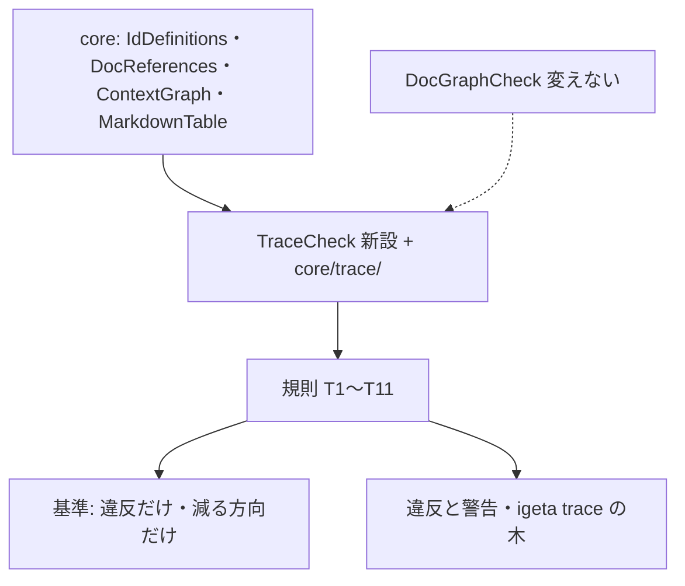

# ADR-0015: 設計書のつながりを検査する — 新設の `TraceCheck` が既存の部品を import し、基準ファイルで段階的に厳しくする

> **TL;DR**: 決定 (DEC)・要件 (REQ)・機能 (FN)・画面 (SCR)・API・表 (TBL)・テスト (TST)・コードの ID が、上流と下流で届くかを機械で見る。
> 検査は新設の `TraceCheck` 1 つにし、ID の定義は `core/IdDefinitions.ts`、参照は `core/DocReferences.ts` から import する。
> 既存の違反は基準ファイルに記録し、新しい違反だけを落とす。基準は減らす方向だけに動かす。
> - 却下: `DocGraphCheck` を広げる (ファイルが大きく、別の作業が触っている) / 既存の `SourceCoverageCheck` に足す (見る軸が違う)

## 関連

- **上流 (depends_on)**: ADR-0002 (人の文書の境界。人の文書は AI の文書を指さない)・ADR-0004 (フォルダの構成)
- **下流**: テスト仕様 13 (規則・テストケース)・テスト仕様 14 (雛形・利用 repo への当て方)。両方とも docs/ai/specs/shared/tests/ にある。人の文書からは名前で言及し、リンクしない (G1)

## Status

2026-10-23 提案。方針は CEO が決めた (対象 8 種・ID はコードの先頭行・段階導入は基準方式)。arch-review の FIX (2026-10-23) を反映した。

## Context

- 利用 repo の設計書で、決定から画面へは届いていたが、要件と機能一覧の行が無い。画面が指す機能は一部だけで、関係する機能が抜けていた。API は機能だけを指し、画面や決定へ戻れなかった。表は 1 度もコードから参照されていなかった。
- 既存の検査は、文書の frontmatter と本文リンクの向き (G1〜G4) と、配達章の行の網羅 (`SourceCoverageCheck`) を見る。表の中で ID が上流・下流を指し合う関係は見ていない。
- ID の形は同じ目的のコードに何度も書かれている (`SourceCoverageCheck` の正規表現・`core/DecisionRows.ts` の `idOf`・`AnalyzeModule` と `DiffTraceModule` の `ID_TOKEN_RE`)。統一は別の作業とする。

## Decision Drivers

1. 既存の違反を一度に直せなくても、新しい違反は入れない
2. 検査の部品は 1 か所だけに持つ (MD-06)。`DocGraphCheck` の中身は写さない
3. 人が読んで直せる出力 (○・△・✗ の木と、直す行の場所)

## Decision

**採用: 新設 `src/checks/TraceCheck.ts` と `src/core/trace/` (中身は `core/` の部品を import)。基準ファイルで段階的に厳しくする。**

1. 定義は `core/IdDefinitions.ts` の `collectRowDefinedTokens` を import して数える。重複を残す版が要るので、同ファイルに `collectRowDefinitions` (行番号と重複を返す) を**足す**。既存の関数の挙動は変えない。参照と修飾 ID は `core/DocReferences.ts`・`core/ContextGraph.ts` を使う。
2. 辺は「下流の行が上流の ID を書く」で宣言する。片方向は警告 (△)。例外として、FN が下流に SCR を書き、その SCR の上流に FN が無い組み合わせだけは違反にする (テスト仕様 13 の T9)。
3. T1 は context の中の重複だけを数える。加えて、PR の差分で増えた ID が origin/main に既にあれば違反にする。CI は PR の merge 結果で回す。
4. T7 (表) は、コードの `@trace` でだけ満たす。TST からの参照では満たさない。最初は警告で、基準が空になったら違反に上げる。
5. 違反は基準ファイル `.igeta-trace-baseline.json` (repo 直下) に記録する。違反だけを記録し、警告は入れない。基準は増やせない (origin と比べる)。
6. `igeta trace <ID>` は上流と下流の木を出す (既定は ○・△・✗、`--mermaid` で Mermaid)。既存の `DiffTraceModule` は PR の変更ファイルから FN・REQ を辿るもので、入力も目的も違う。

| 判断軸 | 採用案での扱い | 理由 |
|---|---|---|
| 既存との重複 | 定義と参照は import。規則は新規 | 写すと 2 か所で食い違う (MD-06) |
| 段階導入 | 基準は違反だけ・減る方向だけ | 既存違反を一度に直さず、新しい違反を止める |
| 書き方 | 先頭行に `@trace` | 既存の概要行 (MD-09) と兼ねる |

## 却下した選択肢

- **`DocGraphCheck` を広げる**: 生成索引と frontmatter の検査で既に大きい。別の作業が触っている。
- **`SourceCoverageCheck` に足す**: 配達章と sidecar の網羅を見る検査で、文書内の ID の上流・下流は見ない。
- **外部ツールとして別に作る**: ID の定義と参照を二重に持つ (MD-06 に反する)。

## Consequences

- 良い方向: 抜けが見えるようになり、直す行が出る。基準は違反だけなので、後戻りが起きない。
- 代償: 文書に辺の欄を書く必要がある。ID の形は今も 4 か所 (上記) で定義されており、統一は別の作業として残す。

## Confirmation

| 手段 | 対象 | 落ちる条件 |
|---|---|---|
| テスト仕様 13 のケース (901 番〜) | `TraceCheck`・`core/trace/` | T1〜T11 のどれかが期待と違う |
| 基準の検査 | `.igeta-trace-baseline.json` | origin の基準より指紋が増えている |
| 利用 repo での実行 | 利用 repo の全文書 | 基準に無い違反が 1 件でもある |

## 再検討トリガ

- 辺を両方向で書く負担が大きく、△ が 3 回続けて直らなかったら、片方向の扱いを改める
- ID の形の定義が 2 回食い違って見つかったら、統一の作業を始める

## 決めてほしいこと

- 基準ファイルの置き場 (この ADR は repo 直下)。
- **ID-NEXT**: `igeta id next` を作るか。費用は約 150 行 (git の参照を読むだけ)。先に T1 の照合の件数を 1 か月数え、衝突が多ければ作る。
