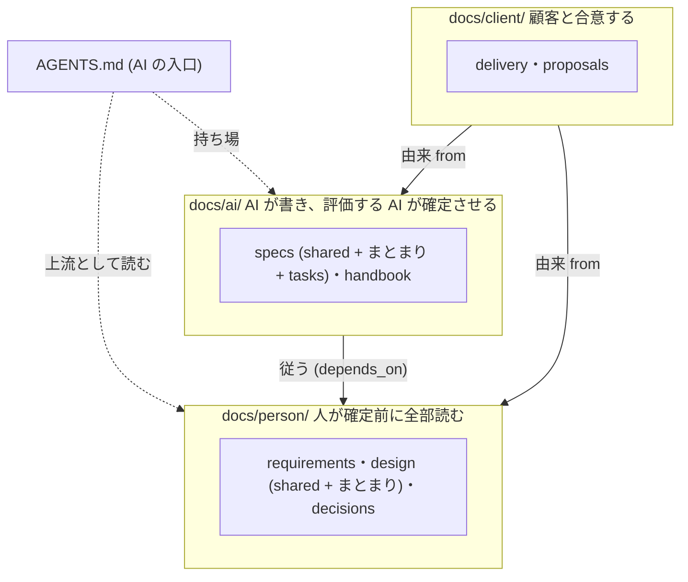

# 文書モデルの解決戦略 — 確定させる人で 3 つに分け、検査で守り、モデルの進化に左右されない

> **TL;DR**: Igeta の文書モデルは 3 本柱。「コードから導けないものだけ手で書く」「人が決める文書と AI が作る文書を
> 置き場所で分け、人の文書は全部読める型と量に保つ」「品質の門は決定的な機械検査」。構造は ADR-0001〜0010
> (`docs/person`・`ai`・`client` + repo 直下の `AGENTS.md`)。本書は、どの決定がどの品質目標に効くかをつなぐ

## 構成の図

## 関連

| 区分 | 文書 | 対応 |
|---|---|---|
| 上流 | [要件定義書](../../requirements/01-requirements.md) / [要件定義書 — 確定させる人ごとのディレクトリ](../../requirements/02-audience-directories.md) | REQ-1xx/2xx |
| 下流 | ADR-0001〜0010 | — |

## 1. 技術選定の要約 (文書モデルの要素)

| ID | 領域 | 採用 | 理由 | 決定元 ADR | 状態 |
|---|---|---|---|---|---|
| SS-001 | docs/ の第 1 階層 | 確定させる人で 3 つ (`person`/`ai`/`client`、小文字) | 置き場所がそのまま承認の要否になる。「両方が読む」場所を作らない | ADR-0001 | 仮 |
| SS-002 | 人の文書の型と量 | 結論 → 図 → 決まりの表 (状態つき)。量の上限 (値は ADR-0002) | 人が全部読んで決められる。実測で本文が元の 26% になった | ADR-0002 | 仮 |
| SS-003 | 中の構造 | まとまりごとのフォルダ。日付の記録は年。1 フォルダ 15 本で違反 | フォルダが読む単位になる。実測 (16〜35 本の平置き) に基づく | ADR-0004 | 仮 |
| SS-004 | 移行とルール化 | 「移す」と「書き直す」の 2 段を 1 本の PR で。強さは構成の実在と版だけで決める | 半端な状態を残さない。設定で迂回できない | ADR-0003/0005 | 仮 |
| SS-005 | 承認が要る変更の見分け | 差分のパスで人の承認の要否を決める | 主体に依存しない決定的な判定 | ADR-0008 | 仮 |
| SS-006 | 置き場所と値の持ち主 | kind 47 種の置き場所の表。人の決める値は person の行に 1 回だけ置き、ai は ID を引く | 決めの本体を人の承認の下に 1 か所だけ置く | ADR-0009/0010 | 仮 |

## 2. 分割方針 (docs/ の軸と依存の向き)

| ID | 論点 | 決め | 破ってはいけない線 | 状態 |
|---|---|---|---|---|
| SS-101 | 第 1 階層 | `person`/`ai`/`client` の 3 分割 | 「両方が読む」置き場所を作らない | 仮 |
| SS-102 | 第 2 階層以下 | まとまりごとのフォルダ。kind ごとの置き場所は ADR-0009 | ADR-0009 の表に無い場所に文書を置かない | 仮 |
| SS-103 | 依存の向き | `ai` → `person`、`client` → `person`・`ai` | `person` から `ai`・`client` を指さない (`relates_to` も含む) | 仮 |
| SS-104 | AI の入口 | repo 直下の `AGENTS.md` | `docs/` の中に入口を作らない | 仮 |

## 3. 品質目標の達成手段 (モデルの進化に左右されない)

| ID | 品質目標 | 弱いモデルでも回る条件 | 強いモデルが出ても無駄にならない条件 | 状態 |
|---|---|---|---|---|
| SS-201 | 人が読むものが分かる | フォルダ名だけで、確定させる人が分かる | 詳細設計が要らなくなっても、人の決定 (`person/`) は残る | 仮 |
| SS-202 | 人も AI も読みきれる | 人の文書は型と量を検査する。AI は `context-files` で範囲を絞る | 上流 (人の決定) が短いほど、どのモデルでも取り違えが減る | 仮 |
| SS-203 | 品質の門 | 雛形の穴埋めで書ける | 検査は正規表現・SHA256・文字列一致・件数だけ。モデルの巧拙に判定が依存しない | 仮 |

## 4. 主要な設計判断 (ADR 一覧)

ADR の一覧は生成索引 ([docs/adr/README.md](../../decisions/2026/README.md)) が出す。本書は §1 の「決定元 ADR」の列で引く。

## 費用の上限

| ID | 項目 | 月額の上限 | 算出の前提 | 超えるときの扱い | 状態 |
|---|---|---|---|---|---|
| SS-211 | Igeta 本体 (CLI とテンプレ) | 無し | Igeta は費用を持たない。利用 repo の実行環境の費用は利用者が持つ | 該当なし | 仮 |

## 使う外部サービス

| ID | 外部サービス | 用途 | 渡すもの | 決定元 ADR | 状態 |
|---|---|---|---|---|---|
| SS-311 | GitHub | CI (`.github/workflows`)・承認の保護 (CODEOWNERS)・版の配布 | 公開リポジトリの内容 (secret-scan を通したもの) | ADR-0008 | 仮 |
| SS-312 | npm レジストリ | 依存の取得と、`igeta` の配布 (`package.json`) | 公開パッケージの名前と版 | — | 仮 |

## 決めてほしいこと

| 問い | 対象 ID | 選択肢 | 決まらないと止まること |
|---|---|---|---|
| ADR-0001〜0011 を accepted にするか (人の承認) | SS-101 | 承認 / 1 本ずつ見直す | 分割方針の行を決定に変えられない |
