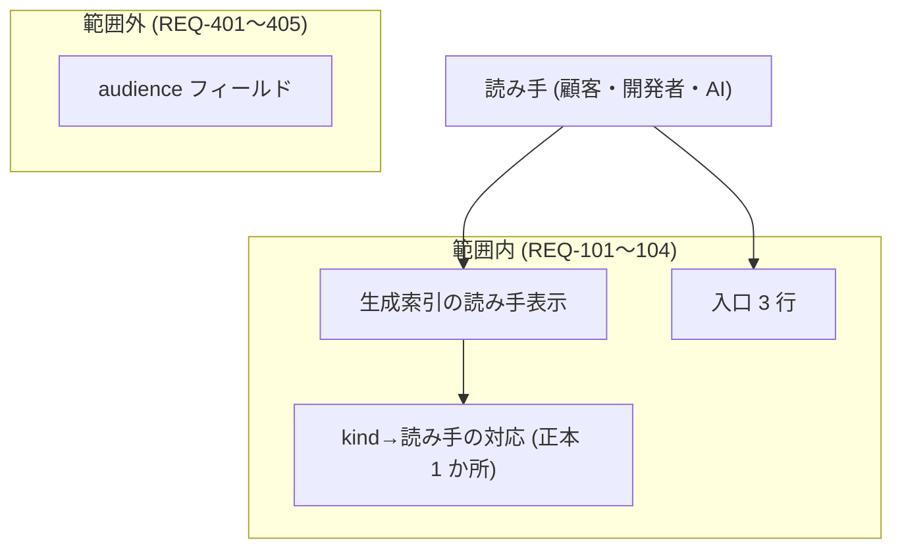

# 要件定義書

> **TL;DR**: docs を開いた読み手が、その文書が **顧客 / 開発者 / AI** の誰向けかを即判別できない、を解く。
> 読み手は frontmatter `kind` から機械判定し、生成索引 (dir-index)・入口・ガイドに表示する。
> - 優先順位 1 位は **生成索引への読み手表示** (REQ-101) のみ。Igeta 本体に効き、索引の再生成で全消費 repo に波及する
> - kind→読み手対応の正本は 1 つ (REQ-102)
> - やらない: `audience` フィールド新設 / 全読み手への由来・検査強制 / 新しい kind (REQ-401〜403)
> - **2026-10-02 改訂**: 読み手の区分 (顧客 / 開発者 / AI / 共通) は、[要件定義書 — 確定させる人ごとのディレクトリ](./02-audience-directories.md)
>   と ADR-0001 v4 で「確定させる人 (人 / AI / 顧客)」に改めた。REQ-101〜104 の表示・入口・ガイドは、実装時に新しい 3 区分へ替える (ADR-0005 決定 4)

## 範囲の図

## 関連

| 区分 | 文書 | 対応 ID |
|---|---|---|
| 上流 (depends_on) | なし (要件は最上流) | — |
| 下流 | 生成索引 (dir-index) / [消費 repo 雛形](../../../templates/docs/README.md) / [文書体系ガイド](../../../templates/docs/ai/handbook/how-to/01-document-taxonomy.md) | REQ-101〜104 |

## 1. 業務要件

| ID | 業務要件 | 現状の課題 | 受入基準 (満たしたと判定できる観測可能な事実) | 出典 | 状態 |
|---|---|---|---|---|---|
| REQ-001 | docs を開いた人・AI が、その文書が顧客・開発者・AI の誰向けかを、文書体系の知識が無くても即判別できる | 読み手 3 種と kind→読み手対応は設計確定済みで層の実体 (まとまりの地図・約束・提出物の章) もあるが、索引・入口・ガイドのどこにも読み手の表示が無い。対応表は 解説 03 §3 (ai 側) にだけあり、docs を開いた人からは見えない | REQ-101〜104 をすべて満たす | 読み手 3 種・入口の構成・kind→読み手対応: explanation/03 §3。「即判別」の定量目標 (秒数・操作数) は**未整備**で、構造的受入条件で代替する | 仮 |
| REQ-002 | 細粒度に分かれた正本文書群を、読み手 (顧客 / 開発者 / AI) が「現時点の全体像」として 1 本の物語で読める | 文書は kind × context × id の小品群と depends_on の木で機械には強いが、索引 (dir-index) は地図であって物語ではない。読み手向けに全体を 1 本の叙述として読む生成物が無い | REQ-405 の再検討条件を満たした版で、読み手別の生成物語 1 本が depends_on の木と kind→読み手対応から生成される (要件化は次段) | Hora Kit (Open Reach Tech) 公開記事との比較 (2026-09-06)。同記事の spec.md が版ごとの物語を持つのに対し、本リポジトリは索引のみ | 仮 |

## 2. 機能要件

| ID | パターン | 要件文 | 対応業務 (REQ-0xx) | 受け入れ条件 | 状態 |
|---|---|---|---|---|---|
| REQ-101 | Event | 索引生成 (dir-index) が走ったとき、システムは各文書を確定させる人 (人 / AI / 顧客) を frontmatter `kind` から機械判定し、生成索引の当該文書の行に表示しなければならない | REQ-001 | 利用 repo で索引を再生成すると、kind を持つ全文書の行に区分が出る。kind を直せば次回生成で表示が変わる。kind を持たない文書は移行のときに一覧で止める (要件 02 REQ-103) | 仮 |
| REQ-102 | Ubiquitous | システムは kind → 確定させる人の対応を 1 か所の正本から導出しなければならない | REQ-001 | 対応の正本は要件定義書 02 §7。索引表示・ガイドの対応表・`Role.ts` はその転記で、一致をテストが確かめる | 仮 |
| REQ-103 | Ubiquitous | 利用 repo の docs/README.md は「入口」として 3 行を持たなければならない。人 → `person/` を確定前に全部読む / AI → `AGENTS.md` から `person/` と `ai/` / 顧客 → `client/` の提出物 | REQ-001 | 新しく起こした利用 repo の docs/README.md に 3 行が含まれ、各行が実在するフォルダを指す。入口の文言は AUTOGEN 索引区間の外にあり、索引の再生成で消えない | 仮 |
| REQ-104 | Ubiquitous | 文書体系ガイドは、確定させる人の 3 区分の節と kind → 置き場所の表を持たなければならない | REQ-001 | ガイドに節と表があり、表の内容は要件定義書 02 §7 と一致する。ガイドは利用 repo に写さず、版に固定した手引きを指す | 仮 |

**優先順位**: 1 位は REQ-101 のみ。REQ-102〜104 は同梱でよいが並列の 1 位は置かない (REQ-101 が効けば残りは表示の導線整備)。

## 3. 制約

| ID | 制約 | 根拠 | 影響範囲 | 状態 |
|---|---|---|---|---|
| REQ-201 | 読み手の判定入力は frontmatter `kind` のみ。新しい frontmatter フィールドを足さない | 解説 03 §2 (ai 側) の却下案 (kind が区別を既に担う。区別用フィールドを 2 つ持たない) | 索引生成・検査・全消費 repo の frontmatter | 仮 |
| REQ-202 | 本書および改める雛形・ガイドは、kind ごとの TL;DR と行数上限を守る | [文書体系ガイド](../../../templates/docs/ai/handbook/how-to/01-document-taxonomy.md) 種類一覧の「上限」列 (requirements は 200 行) | 本書・templates/docs/** | 仮 |
| REQ-203 | 読み手表示に関して検査を足す場合も、重い検査を既定 CI に入れない段階導入の方針を踏む | 解説 03 §6 (ai 側) | CI 既定経路 | 仮 |

## 4. 前提

| ID | 前提 | 未確認/確認済 | 崩れた場合の影響 | 状態 |
|---|---|---|---|---|
| REQ-301 | (作り方のため ai/ へ移した) |  |  | 廃 |
| REQ-302 | (作り方のため ai/ へ移した) |  |  | 廃 |
| REQ-303 | (作り方のため ai/ へ移した) |  |  | 廃 |

## 5. スコープ外

| ID | スコープ外の内容 | 理由 | 再検討する条件 | 状態 |
|---|---|---|---|---|
| REQ-401 | frontmatter `audience` フィールドの新設 | 解説 03 §2 (ai 側) で却下済み (kind が区別を担う) | kind から判定できない読み手区分が出たとき | 仮 |
| REQ-402 | 全読み手への由来・鮮度・網羅・合意台帳の強制 | 同 §2・§6 (重い仕組みは delivery-chapter だけ。レビューし切れない量を全読み手に課さない) | 読み手別運用が安定し、個別読み手へ広める判断が出たとき | 仮 |
| REQ-403 | 新しい kind の追加 | 同 §2 (既存 kind の組み合わせで足りる) | 対応表に載らない文書種別が生まれたとき | 仮 |
| REQ-404 | 既存の消費 repo への一括反映・移行作業 | 本書は Igeta 本体側の仕組みの要件。各 repo には索引の再生成で段階的に効く | 特定 repo への即時展開が必要になったとき | 仮 |
| REQ-405 | 読み手別の「生成物語」— depends_on の木と kind→読み手対応から、読み手ごとの「現時点の全体像」文書 1 本を生成する機能 | 本版は読み手の「表示」(REQ-101〜104) に絞る。生成は正本の機械判定と入口整備が消費 repo に効いてから意味を持つ。作業中の実装に同梱しない | REQ-101〜104 が消費 repo に効き、次の版の要件として起案するとき (REQ-002 の受入として扱う) | 仮 |

## 決めてほしいこと

| 問い | 対象 ID | 選択肢 | 決まらないと止まること |
|---|---|---|---|
| 「即判別」の定量目標 (判別までの秒数・操作数) を置くか。計測の手当てが無いので、いまは構造的な受入条件で代える | REQ-001 | 定める / 構造的な条件のまま | REQ-001 の完了を数で判定できない |
| kind→読み手対応の正本の形 (定数か表か) と、単一性の検査を既定 CI に入れるか | REQ-102 | 定数 / 表、既定 CI / opt-in | REQ-102 の実装の形が決まらない |
| 対象外 (双方が読む解説・手引き) の索引上の表示語 (「共通」) | REQ-101 | 共通 / 別の語 | REQ-101 の表示語が決まらない |
