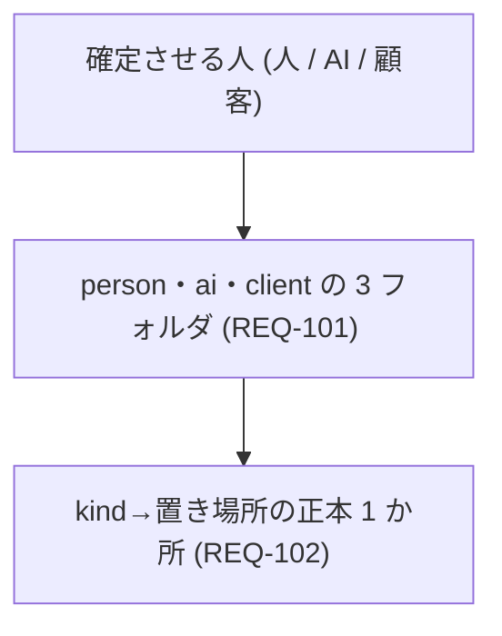

# 要件定義書 — 確定させる人ごとのディレクトリ (docs/ の物理分割)

> **TL;DR**: docs/ を開いた人が、文書を確定させる人 (人 / AI / 顧客) でフォルダだけで判別できない、を解く。
> 置き場所は kind から決め、違反は検査で落とす。人の文書は、人が全部読める型と量に保つ
> - やらない: `audience` フィールドの新設 / 新しい kind / 読み手別の生成物語 (前版のスコープ外を継続)

## 範囲の図

## 関連

| 区分 | 文書 | 対応 ID |
|---|---|---|
| 上流 (depends_on) | [要件定義書](./01-requirements.md) — 読み手表示 (索引・入口・ガイド) | REQ-101〜104 |
| 下流 | ADR-0001〜0011 | REQ-101〜107 |

## 1. 業務要件

| ID | 業務要件 | 現状の課題 | 受入基準 (満たしたと判定できる観測可能な事実) | 出典 | 状態 |
|---|---|---|---|---|---|
| REQ-001 | docs/ を開いた人が、文書を開く前にフォルダだけで「人が決める文書」「AI が使う文書」を判別できる | v0.4.0 の表示は索引経由だけ。人が決める決まりが AI 側の場所にある | REQ-101〜106 をすべて満たす | CEO 指摘 (「どれが人間が読むもので、AIがどれかわかりません」) | 仮 |
| REQ-002 | 人が、自分の決める文書を 1 つのフォルダから全部たどれ、全部読める量に収まっている | 決める内容と作り方が 1 本に混ざり、そのまま移すと約 31 万字で読みきれない | person/ の文書が ADR-0002 の型と量の条件を満たす | CEO 指摘 (2026-10-02): 「読みきれるボリュームなの？」 | 仮 |
| REQ-003 | 人が読んで承認する文書は、表を読む前に、図で範囲・関係・順序・置き場所が見える | v0.5.0 の person の雛形 19 本のうち、図があるのは 6 本。残りは表だけ | REQ-107 を満たす | CEO 指摘 (原文 2026-10-08): 「人間のものは視覚的に」 | 仮 |

## 2. 機能要件

| ID | パターン | 要件文 | 対応業務 (REQ-0xx) | 受け入れ条件 | 状態 |
|---|---|---|---|---|---|
| REQ-101 | Ubiquitous | システムは docs/ 直下を、`person`・`ai`・`client` の 3 ディレクトリと生成索引の 2 本だけに制限しなければならない | REQ-001 | 新しい構成の repo で、docs/ 直下に他のディレクトリや文書があると検査が落ちる (ADR-0005 決定 1) | 仮 |
| REQ-102 | Ubiquitous | システムは kind → 置き場所の対応を 1 か所の正本から導出しなければならない | REQ-001 | 対応の正本は本書 §7 の 1 か所。`src/core/Role.ts` の表がガイドの表と一致し、`ARC42_BY_KIND` の全 kind を含む (ADR-0002 条件 1、ADR-0005 決定 2) | 仮 |
| REQ-103 | Unwanted | 文書の kind・`context` から導く置き場所と、実際の置き場所が食い違う場合、システムは検査で違反として検出しなければならない | REQ-001 | 食い違う文書を置くと検査が落ちる。kind の無い文書は移行のときに一覧で止める (ADR-0003 決定 4) | 仮 |
| REQ-104 | Event | `igeta init` / scaffold で repo を起こしたとき、システムは 3 ディレクトリの構成の docs を生成しなければならない | REQ-001 | 生成直後の repo で全検査が通り、索引が新しいパスを指す | 仮 |
| REQ-105 | Event | 旧い構成の repo を移行するとき、システムは移す段を適用まで機械的に行わなければならない | REQ-002 | 移す段の完了条件 (C1〜C5) を満たし、残る違反を書き直す段の作業の列として出す | 仮 |
| REQ-106 | State | 旧い構成の repo が残っている間、システムは既存の検査を動かし、移行を促す警告を出さなければならない | REQ-001 | 旧い構成の repo で既存の検査が通り、毎回警告が出る。次のメジャー版で違反になる (ADR-0005 決定 1) | 仮 |
| REQ-107 | Ubiquitous | §8 の kind の人の文書は、許す図種の Mermaid の図を冒頭に 1 枚以上持たなければならない | REQ-003 | 図が無い・空・別図種・閉じていない・冒頭の外のどれかなら検査が落ちる | 仮 |

## 3. 制約

| ID | 制約 | 根拠 | 影響範囲 | 状態 |
|---|---|---|---|---|
| REQ-201 | 置き場所の判定に使う入力は frontmatter の `kind` と `context` だけ。`audience` などの新しいフィールドを足さない | [要件定義書](./01-requirements.md) REQ-201 | 検査・索引・全利用 repo の frontmatter | 仮 |
| REQ-202 | 新しい kind を足さない。区別は置き場所で担う | 同 REQ-403 | kind の登録 (テンプレ・検査) | 仮 |
| REQ-203 | ディレクトリ名は ASCII 小文字。日本語の表示名 (人 / AI / 顧客) は表示にだけ使う | URL・glob にそのまま使える形にする | 正本・テンプレ・入口の文言 | 仮 |
| REQ-204 | 本書と改める雛形・ガイドは、kind ごとの TL;DR と行数上限を守る | [文書体系ガイド](../../../templates/docs/ai/handbook/how-to/01-document-taxonomy.md) | 本書・templates/docs/** | 仮 |
| REQ-205 | 検査の強さは、構成の実在と Igeta の版だけで決め、利用 repo の設定では変えられない | CEO 指摘「直したらルールとして設定して」 | CI の既定の経路 | 仮 |

## 4. 前提

| ID | 前提 | 未確認/確認済 | 崩れた場合の影響 | 状態 |
|---|---|---|---|---|
| REQ-301 | (作り方のため ai/ へ移した) |  |  | 廃 |
| REQ-302 | (作り方のため ai/ へ移した) |  |  | 廃 |
| REQ-303 | (作り方のため ai/ へ移した) |  |  | 廃 |
| REQ-304 | (作り方のため ai/ へ移した) |  |  | 廃 |
| REQ-305 | (作り方のため ai/ へ移した) |  |  | 廃 |

## 5. スコープ外

| ID | スコープ外の内容 | 理由 | 再検討する条件 | 状態 |
|---|---|---|---|---|
| REQ-401 | frontmatter `audience` フィールドの新設 | kind と置き場所が区別を担う | kind と置き場所で判定できない区分が出たとき | 仮 |
| REQ-402 | 新しい kind の追加 (`data-management` は予約済みの kind に雛形を作るだけ) | 既存の kind で足りる | 表に載らない文書の種類が生まれたとき | 仮 |
| REQ-403 | 読み手別の「生成物語」 | 本版は物理分割と型・量に絞る | 3 ディレクトリが利用 repo に効いた後 | 仮 |
| REQ-404 | 凍結予定の大きな社内 repo の移行 | 工数をかける理由が無い | 凍結が解除されたとき | 仮 |

## 6. 決めてほしいこと

| 問い | 対象 ID | 選択肢 | 決まらないと止まること |
|---|---|---|---|
| 人の承認の持ち主 (CODEOWNERS と AGENTS.md の @user・@org/team) を誰にするか | REQ-105 | 1 人 / チーム | 承認の割り当てが確定せず、移行の完了条件 C2 の持ち主が決まらない |

## 7. kind の置き場所 (正本)

kind → 置き場所の対応の正本 (REQ-102)。決定の記録は ADR-0009。文書体系ガイドと `src/core/Role.ts` はこの表の転記で、
`TaxonomyGuideSync.test.ts` が 3 つを突き合わせる。`<c>` はまとまりの名前 (`shared` を含む)。ただし同じ階層の固定のフォルダの名前 (`ai/specs/` の下の `tasks`) には当たらず、context-contract の `<c>` は `shared` も除く (全体共通はどのまとまりからも引けるので、約束を持たない)。
型の検査: ○ = 状態の列・決まりの表・行数 (100 行。requirements は 150 行) を検査する。図 = 図だけを検査。— = 検査しない。図が要る kind と図種は、この列と別に §8 が決める。

| 確定させる人 | kind | 置き場所 | 型の検査 |
|---|---|---|---|
| person | map / context-map | `person/design/shared/00-map.md` / `person/design/<c>/00-map.md` | 図 |
| person | requirements | `person/requirements/01-requirements.md`・`person/requirements/NN-slug.md` | ○ |
| person | function-list / solution-strategy / nonfunctional / permission-matrix / data-management / as-is-overview / risks-tech-debt / operations / migration-plan | `person/design/shared/NN-*.md` (固定番号)。100 行を超えたら `person/design/<c>/NN-<kind>.md` にも置ける | ○ |
| person | business-flow / screen-spec / feature-brief | `person/design/<c>/{flows,screens,features}/NN-slug.md` | ○ / ○ / — |
| person | glossary | `person/design/shared/NN-glossary.md` | — |
| person | adr / decision-log | `person/decisions/{proposed/NNNN-slug.md,accepted/<year>/NNNN-slug.md,rejected/<year>/NNNN-slug.md,retired/<year>/NNNN-slug.md}` (状態でフォルダを分ける。旧い `person/decisions/<year>/NNNN-slug.md` は移行するまで許し、docs-check が警告にする) / `person/decisions/01-decisions.md` | — |
| ai | crosscutting / code-definitions / messages / i18n / infra-design / secrets-management / external-integration / test-plan / domain-overview / aggregate-map | `ai/specs/shared/NN-*.md` (固定番号) | — |
| ai | context-contract | `ai/specs/<c>/contract.md` | — |
| ai | api-spec / table-spec / domain-model / sequence-spec / state-machine / module-spec / job / test-spec | `ai/specs/<c>/{api,tables,domain,sequences,state-machines,modules,jobs,tests}/NN-slug.md` | — |
| ai | tasks | `ai/specs/tasks/NN-slug.md` | — |
| ai | guide / explanation / runbook / implementation-order | `ai/handbook/{how-to,explanation,runbooks}/NN-slug.md` (implementation-order は `how-to/02-implementation-order.md`) | — |
| ai | document-taxonomy / human-review / provenance-workflow | 利用 repo には置かない。`AGENTS.md` と docs/README.md から、版に固定した Igeta の手引きを指す | — |
| client | delivery-chapter / proposal | `client/delivery/<提出物名>/` / `client/proposals/<year>/NN-slug.md` | — |

計 47 kind (person 18・ai 27・client 2) で、`ARC42_BY_KIND` の全件。`tutorial` (予約済み) は 47 の外で、登録するときは `ai/handbook/` に置く。

| 決まり | 内容 |
|---|---|
| 置ける場所 | 上の表のパスと、生成索引 (docs/ 直下の 2 本、各フォルダの README.md) だけ |
| 15 本の対象外 | `person/decisions/{proposed,accepted/<year>,rejected/<year>,retired/<year>,<year>}/`・`client/proposals/<year>/`・`client/delivery/<提出物名>/` |
| `person/design/<c>/` と `ai/specs/<c>/` の下が 15 本を超えた | まとまりを分ける合図。下位フォルダは足さない |
| `person/design/shared/` の固定の文書が 100 行を超えた | 行を、属するまとまりの `person/design/<c>/NN-<kind>.md` へ移す (行の移動の扱いは ADR-0006 決定 7) |
| `person/requirements/01-requirements.md` が 150 行を超えた | まとまりごとに `person/requirements/NN-<c>.md` へ分ける (同上) |
| `ai/specs/tasks/`・`ai/handbook/` の 3 フォルダが 15 本を超えた | まとまりの下位フォルダ (`shared` を含む) へ全部移す。`shared` が 15 本を超えたら違反のまま |

## 8. 人の文書の冒頭の図 (正本)

図が要る kind と図種の正本 (REQ-107、記録は ADR-0011)。`Role.ts` と雛形はこの表の転記。図は TL;DR の次の節、最初の表より前に置く。
図に書くのは名前・ID・関係で、値は行が持つ (例外は ADR-0011 決定 4)。表は消さない。図種は図の先頭の語 (`graph` = flowchart)。

| kind | 許す図種 | 図で一目で分かること |
|---|---|---|
| map | flowchart / mindmap | 何を作る仕組みか、主要な流れ |
| context-map | flowchart | このまとまりと隣のまとまりのやり取り |
| requirements | flowchart | この案件の範囲内と範囲外 |
| function-list | mindmap / flowchart | 機能がどのまとまり・段階に分かれるか |
| solution-strategy / as-is-overview | flowchart | 部品と置き場所 (DB は筒。向きは TB) |
| nonfunctional | quadrantChart / mindmap | どの指標が厳しく、費用に効くか |
| permission-matrix | flowchart | ロールと、触れてよいデータ範囲 |
| data-management | flowchart | データが置かれる国・環境と、消える時期 |
| risks-tech-debt | quadrantChart | 確率 × 影響で、どのリスクを先に見るか |
| operations | flowchart | 障害の検知から復旧までの連絡の流れ |
| migration-plan | flowchart / gantt / timeline | 切り替えの段階・関門・切戻し |
| business-flow | flowchart / sequenceDiagram | 業務の流れと、誰がやるか |
| screen-spec | flowchart / stateDiagram | 画面の行き来 |
| glossary | flowchart / mindmap | 混同しやすい語の関係 |
| decision-log | flowchart / timeline | 未決が何を止め、決定が何に効くか |

図が要らない kind: adr・feature-brief (ADR-0011 決定 2)。
