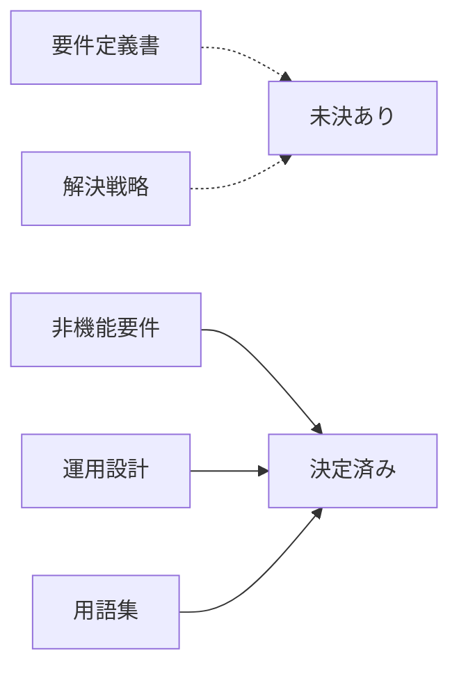

# 決定台帳

> **TL;DR**: この案件で人が決めたこと・まだ決めていないことの一覧。仮置きの値は全部 OPEN-nnn を持つ。
> - <直近で一番影響が大きい決定>
> - <一番早く決めないと設計が止まる未決事項>

## 1. 文書ごとの決定の状況

## 2. 決定 (DEC)

状態は `✅ 決定` か `↪ 廃`。決定の根拠は、決めた場所へのリンク (PR・Issue・会議録・fd) か、repo の中のファイルのパス。

| ID | 状態 | 日付 | 決めた人 | 原文 | 根拠 | 決定 | 影響する文書 |
|---|---|---|---|---|---|---|---|
| DEC-001 | ✅ 決定 | <決めた日付> | <決めた人> | <決めた人の発言・記述の引用> | <出所へのリンク> | <決定した内容> | <影響する文書の修飾 ID> |

## 3. 未決 (OPEN)

状態は `⏳ 未決`・`⏳ 暫定`・`✅ 解決`。未決と暫定は持ち主と期限 (YYYY-MM-DD) が要る。解決の根拠には、決めた DEC の ID を書く。

| ID | 状態 | 論点 | 推奨案 | 暫定値 | 持ち主 | 期限 | 根拠 | 影響する文書 |
|---|---|---|---|---|---|---|---|---|
| OPEN-001 | ⏳ 未決 | <決めていない論点> | <推奨する案> | <仮置きしている値> | <決める人> | YYYY-MM-DD | <論点の出所へのリンク> | <影響する文書の修飾 ID> |

## 4. 仮置き一覧 (自動生成)

<!-- AUTOGEN:tentative-index:start — generated by scripts/generate-docs-graph.mjs, do not edit by hand -->
<!-- AUTOGEN:tentative-index:end -->

## 関連

| 区分 | 文書 | 対応 ID |
|---|---|---|
| 上流 (depends_on) | なし (人の入口。地図と対になる) | — |
| 下流 | (生成索引が出す) | DEC-* / OPEN-* |
